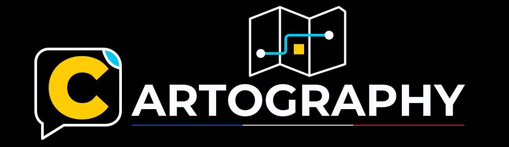

<p align="center">
  
</p>

# cartography-plugins

A Claude Code plugin marketplace holding three workspace-agnostic plugins: `cartography`,
`feature-spec` and `c4`. The first is described below; the other two have their own sections
further down.
Commit and pull request conventions live in the `yoshomura-git-managment` marketplace.

## What the plugin does

It reverse engineers an existing system and maps it by **functionality**, not by code, and it
produces three artifacts that answer three questions asked at three different moments:

| Artifact | Question | Read |
|---|---|---|
| `docs/map.md` | Where is what, what enters, what leaves | Whole, for impact analysis |
| `docs/details/<USE-CASE>.md` | What the implementation of one use case does, and the rules it applies | One at a time, when designing |
| `docs/refusals.md` | What comes back when the deployable says no | Whole, when integrating |

They are committed and **not normative**. The specification of the system stays the source of
truth; these are measuring instruments, and each says so in its own header.

The specification they are compared with is organized by **feature** (a functionality) and
**use case** (one goal reached by one means), each use case holding its **scenarios** and
**business rules**, each feature its **invariants**, all with fixed identifiers such as
`SIGNIN-PASSKEY-SCENARIO-2`. The `feature-spec` plugin writes that specification.

The system is read from one of two sources, declared by the `source` key of every artifact and
equal variants of the same reverse engineering:

| `source` | What is read | The implementation is |
|---|---|---|
| `code` | Existing code, in any language and any folder layout | the path of the existing file implementing the use case |
| `functionality` | A functionality observed or described: a product studied from the outside, a user interface, network traffic, a specification, documentation | a name, the title of the use case, unique in the set |

An absent `source` reads `code`.

## What it ships

| Component | Name | Role |
|---|---|---|
| Agent | `cartographer` | The judgment: what to attach to what, what to report, what never to write |
| Agent | `scout` | A lookup at one coordinate, answering one question, returning code or the observed evidence |
| Skill | `cartography:cartography` | The format: specification, one template set per source, validator |

The agent and the skill are separated on purpose. A shape reproduced from memory drifts run
after run until two repositories stop being comparable; judgment cannot be templated at all.
They change at different rates, so they live in different files.

## Install

```
/plugin marketplace add Yoshomura/cartography-plugins
/plugin install cartography@cartography-plugins
```

To declare it for a repository, commit this to that repository's `.claude/settings.json`:

```json
{
  "extraKnownMarketplaces": {
    "cartography-plugins": {
      "source": {
        "source": "github",
        "repo": "Yoshomura/cartography-plugins",
        "ref": "2.2.0"
      }
    }
  },
  "enabledPlugins": {
    "cartography@cartography-plugins": true
  }
}
```

The `ref` is what makes the version a property of the **repository** rather than of the
developer's machine: each repository pins its tag, bumps it alone, and the bump is a reviewable
commit. The `ref` is a repository version, `X.Y.Z`: it checks out the whole marketplace at one
commit, so a repository using both plugins pins one tag and takes both as they stand at that
tag (see [Versioning](#versioning)). Keep marketplace auto-update disabled, otherwise a
background refresh walks past the pin.

Two things to know when adopting it:

- A project-declared plugin from an external source does not install itself. The repository
  records the requirement; each developer still runs `claude plugin install`.
- A project's own `.claude/agents/` **overrides** a plugin agent of the same name. Delete the
  local `cartographer.md` and `scout.md` when adopting the plugin, or the plugin's versions
  never take effect.

## The other plugin: feature-spec

A raw product idea becomes one feature of the functional specification through a mandatory
sequence: mode selection (interactive or silent), challenge, interview, write.

| Component | Name | Role |
|---|---|---|
| Agent | `spec-writer` | The conception agent. Grounds the idea in the project's reference material, never invents a missing fact, never settles an open reflection, never publishes |
| Skill | `feature-spec:workflow-feature-spec` | The vocabulary, the sequence, the hard rules, the checklist, and the templates `references/feature.template.md` and `references/use-case.template.md` |

The specification is organized by feature and use case:

```
docs/specifications/
├── features.md                       index of the features
└── sign-in/                          one folder per feature
    ├── sign-in.md                    goal, facts, invariants, use cases, decisions, open questions
    └── sign-in-with-passkey.md       one file per use case: goal, business rules, scenarios
```

A use case is one goal reached by one means: two means of reaching the same goal are two use
cases. Invariants, business rules and scenarios carry fixed identifiers in full words
(`SIGNIN-INVARIANT-1`, `SIGNIN-PASSKEY-BUSINESS-RULE-1`, `SIGNIN-PASSKEY-SCENARIO-2`); "rule"
alone is never used, since a rule is also an instruction file of a coding agent harness. Each
scenario has a sentence of 120 characters at most, usable as a ticket title, and its Given /
When / Then. Tests are grouped under the identifier they cover.

The skill ships a checker of that shape, run on a feature folder or on the whole specification
folder:

```
python "${CLAUDE_PLUGIN_ROOT}/skills/workflow-feature-spec/scripts/check_specification.py" docs/specifications
```

It checks the form, never the content: identifiers and their numbering, sections and their
order, the use cases listed by the feature, and every scenario's sentence and Given / When /
Then. Its fixtures live in `tests/feature-spec/fixtures/`:

```
python -m unittest discover -s tests/feature-spec -v
```

Default paths are `docs/Features TODO/` for the idea inbox, `docs/specifications/<feature>/`
for the specification and `docs/archives/<year>/<feature>/notes-before-spec-<feature>.md` for
the archived idea. A project overrides them in its `CLAUDE.md` or `AGENTS.md`. What happens to
a specification afterwards (validation, publication, ticket derivation) belongs to the host
project.

Install it the same way as `cartography`:

```
/plugin install feature-spec@cartography-plugins
```

The same override caveat applies: a project's own `.claude/agents/spec-writer.md` shadows the
plugin's version.

`git-conventions`, formerly in this marketplace, is removed: its scope is covered by the
`commit-and-pr` plugin of `yoshomura-git-managment`. The catalog maps its name to `null` in
`renames`, so an existing install is dropped cleanly.

## The third plugin: c4

C4 architecture diagrams, Level 1 (System Context) and Level 2 (Containers), in one notation and
three formats: Mermaid to design and reverse engineer, draw.io as the versioned reference, a
self-contained HTML page to present.

| Component | Name | Role |
|---|---|---|
| Skill | `c4:c4-diagrams` | The design system (`references/notation.md`: classic C4 palette, shapes, wording, message buses, draw.io styles, Mermaid mapping), the drawing library (`scripts/c4lib.py`, `scripts/c4drawio.py`) and a draw.io importer |
| Skill | `c4:c4-subdomain-view` | The view of one sub-domain with every link in or out of it, generated from one JSON model in Mermaid and draw.io at once |

The sub-domain view stacks the public bus on top, the sub-domain in focus in the middle and the
private buses at the bottom; every other sub-domain is one box. Messages run on at most two lanes
per element and bus, vermillion to the bus and blue from it, each listing its message names; a
database sits below its sub-domain with one link listing every access; a data sink sits below the
store it exports. The generator routes every link orthogonally around the boxes and centres each
label on its line:

```
python "${CLAUDE_PLUGIN_ROOT}/skills/c4-subdomain-view/scripts/subdomain_view.py" all models/ordering.json
```

It writes `architecture/mermaid/c4-ordering.md` and `architecture/drawio/c4-ordering.drawio` from
the current directory (`--mermaid-dir` and `--drawio-dir` change the folders). The draw.io needs
Python only; the Mermaid view needs Node.js and Playwright, which render it with Mermaid to fit
its rows and move its labels off the boxes. The examples, an online shop and its Ordering
sub-domain, ship with the skills. The tests cover the draw.io generation and the model checks:

```
python -m unittest discover -s tests/c4 -v
```

Install it the same way:

```
/plugin install c4@cartography-plugins
```

## The validator

```
python "${CLAUDE_PLUGIN_ROOT}/skills/cartography/scripts/validate.py" docs
```

It checks the **form**, never the content: frontmatter keys, a header blockquote copied
character for character from the set of the file's source, sections present and in order, the
scenario counter, the implementation (a file path of any language with source `code`, a unique
plain name with source `functionality`), the anchors of an observed functionality, the summary length, the
refusal mechanisms, orphan detail entries, and a list of banned vocabulary — purpose, judgment
and supposition, the three ways an observation turns into an invention.

Its fixtures live in `tests/cartography/fixtures/`, one folder per set, `pass-*` or `fail-*`:

```
python -m unittest discover -s tests/cartography -v
```

Exit 0 when everything conforms, 1 otherwise.

**Consider committing a copy of the validator in each mapped repository.** Shipped only here,
a wrong plugin version validates its own output; committed beside the artifacts, it catches a
map produced by the wrong version, which pinning alone does not cover.

## Security scanning

Every push to `main` and every pull request touching `plugins/` runs
[skill-scanner](https://github.com/cisco-ai-defense/skill-scanner), which looks for prompt
injection, data exfiltration and malicious code patterns in skill and agent content.

```
skill-scanner scan-all plugins/cartography/skills --recursive --fail-on-severity high
skill-scanner scan-all plugins/cartography/agents --recursive --lenient --fail-on-severity high
```

`--lenient` on the agents: they are not skills and carry no `SKILL.md`. The scanner version is
pinned in the workflow, so an update to it is a deliberate commit rather than a run that turns
red on a repository which has not changed.

**HIGH and CRITICAL block the merge. Everything below is reported and does not.** The scanner
describes itself as best-effort, and a gate that fires on every INFO is a gate people learn to
ignore.

The job log carries the findings in full, and each run attaches an HTML report per target as an
artifact. This repository is private on a personal account, where code scanning needs a GitHub
Code Security licence, so nothing here uploads SARIF: it would only be useful to a machine that
ingests it, and there is none.

⚠️ Best-effort detection. A scan returning nothing does not mean the plugin is free of threats.

## Business- and technology-agnostic, by construction

No domain term appears in the plugin or in its templates, and no language, framework or folder
convention either. That is deliberate and it is the criterion the architecture it serves sets
for a shared technical library: if another company, with entirely different business rules and
another stack, could use it as-is, it carries no business rule and no technology choice.

## Versioning

**Every version is a Semantic Versioning 2.0.0 string**, `MAJOR.MINOR.PATCH` with an optional
`-prerelease` and `+build`, and no `v` prefix. `.github/scripts/semver.py` validates and orders
them. There are two of them, and they answer two different questions.

| Version | Answers | Lives in | Tag |
|---|---|---|---|
| **Repository** | What does a consumer that pins this marketplace with `ref` risk? | No file | `X.Y.Z` |
| **Plugin** | What does a user of this plugin, or a plugin depending on it, risk? | `version` of `plugins/<plugin>/.claude-plugin/plugin.json`, never the marketplace entry | `<plugin>--vX.Y.Z` |

A `ref` checks out the whole marketplace at one commit, so a consumer pins the repository
version. The plugin tag follows the convention Claude Code resolves dependency version ranges
against, such as `{ "name": "cartography", "version": "~2.1.0" }`.

### Both are published at the merge

Each pull request carries exactly one label: `release:major`, `release:minor`, `release:patch`
or `release:none`, and raises the `version` of every plugin it changes. When it is merged on
`master`, `.github/workflows/release.yml`:

1. takes the highest repository tag, raises it by the label's level and tags the merge commit,
   `1.0.0` when no release exists yet;
2. tags the same commit `<plugin>--v<version>` for every plugin whose current version has no
   tag yet;
3. publishes one release under the repository version, its notes being the `## Release notes`
   section of the pull request body, followed by the plugin tags.

The workflow never commits and never pushes a branch: `master` changes only through a merged
pull request. Nobody tags by hand, and a published tag is **never moved**: a repository pinned
to it must receive the same bytes forever.

The `release label` check refuses a pull request that carries no release label or more than
one, that changes `plugins/` or `.claude-plugin/` under `release:none`, that releases without a
non-empty `## Release notes` section, that changes a plugin without raising its version, that
leaves a plugin without a valid semantic version, that puts a `version` in a marketplace entry,
or whose label is lower than the highest plugin move: a plugin raised to a new major, or removed
from the catalog, makes the repository release a major. The
[releases](https://github.com/Yoshomura/cartography-plugins/releases) are the changelog;
`CHANGELOG.md` is the frozen history of the releases made before this scheme.

### Example

From repository `3.0.0`, one pull request raises `cartography` from `2.1.0` to `3.0.0`, a major,
and `feature-spec` from `2.1.0` to `2.2.0`, a minor. Its label must be `release:major`. The merge
publishes `4.0.0`, `cartography--v3.0.0` and `feature-spec--v2.2.0` on the same commit. A
consumer pinned to `3.0.0` sees nothing until it moves its `ref` to `4.0.0`; a plugin depending
on `cartography` with `~2.1.0` keeps resolving to `cartography--v2.1.0`.

### Which level is a human ruling

The workflow checks that the numbers exist, that they go up, and that the repository level
covers the plugin levels. It says nothing about the level itself: it is a statement about what
a consumer pinned to the previous version would suffer, and only a person knows that. The level
is proposed from this table and decided by a human, never picked silently.

| Level | What justifies it |
|---|---|
| **major** | A plugin removed from the catalog, an agent or a skill removed or renamed, a `${CLAUDE_PLUGIN_ROOT}` path moved, a format change that invalidates artifacts already committed in a consuming repository |
| **minor** | An agent, a skill, a script or a format section added, artifacts already committed staying valid |
| **patch** | Wording, a comment, a validator fix that changes no format |

`release:none` is for a change that ships nothing through the pin: the CI, this README, the
harness.

## License

[MIT](LICENSE), copyright Nicolas Jouet (Yoshomura). Each plugin folder carries its own copy of
the license, because an installed plugin is copied without the rest of this repository.

The documents the plugins produce belong to whoever produces them. Each one carries a
`Generated with <plugin> <version>` line pointing at this repository: a footer in the
cartography map and in a feature file, a comment or a `generator` tag in a C4 diagram. It says
which version wrote the document, no check requires it, and it can be removed.
